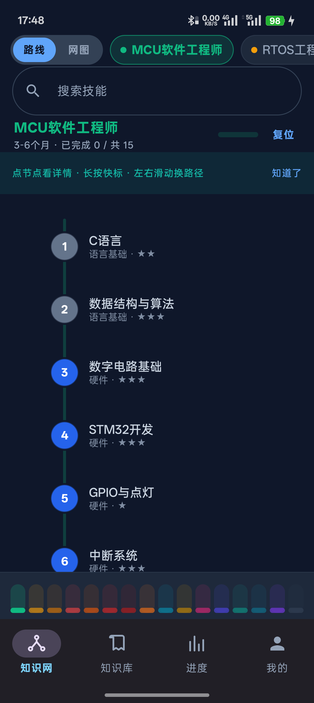
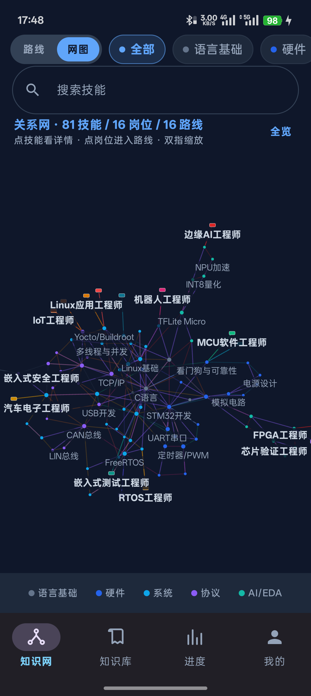
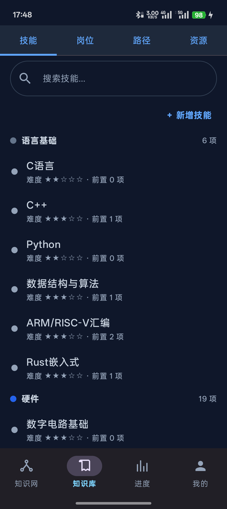
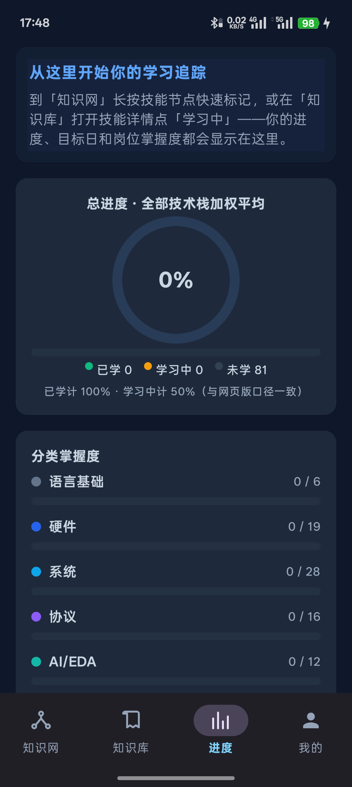

# 嵌入式知识网 · Embedded Knowledge Net

> 把「嵌入式工程师该学什么」做成一张能点开、能追踪的网：16 条岗位路线纵向成线，81 个技能在路线之间交叉成网。

Android 端离线知识工作台，Jetpack Compose 全自绘。所有数据存在本机，不联网也能用；支持与配套网页版通过 JSON 双向导入导出。


## 截图

| 路线视图 | 关系网 |
|---|---|
|  |  |
| **知识库** | **进度** |
|  |  |

## 两种看知识的方式

**路线视图**：一屏专注一条岗位路线。左侧轨道纵向串联技能，节点编号即学习顺序，右侧是名称 + 分类 + 难度；轨道本身按完成度着色，末端是目标岗位卡。上下滑动看整条路线，左右滑动换路线，双指缩放，缩到 0.5 倍自动切成多路线概览。

**关系网视图**：81 个技能 + 16 个岗位作为节点，三类边——前置关系（紫）、同路线相邻（路线色淡线）、路线末节点 → 目标岗位（粗线）。用力导向布局算出真实结构；同一个技能常被多条路线共用，网就自然连起来了。点岗位直接进入那条路线，点技能打开详情。

## 功能

- **技能追踪**：未学 / 学习中 / 已学三态，长按知识网节点即可切换并带触感反馈；支持学习笔记、开始日期、目标完成日与倒计时
- **知识库**：技能 / 岗位 / 路径 / 资源四分页，搜索、详情、新增、编辑、隐藏与恢复
- **进度**：加权总进度环、分类掌握度、岗位掌握度、今日学习卡片
- **数据互通**：与网页版 JSON 双向互导（覆盖导入 / 合并导入 / 导出备份）
- **外观**：跟随系统 / 浅色 / 深色；「减少动画」开关，并尊重系统「移除动画」设置

## 安装

从 [Releases](../../releases) 下载 `LearningGuider-1.0.0.apk`（约 2.3 MB，要求 Android 8.0+），传到手机直接安装。

- 签名：APK Signature Scheme v2 + v3
- 首次启动会把内置知识库（81 技能 / 16 岗位 / 16 路线 / 6 类资源）导入本地数据库，之后完全离线

## 从源码构建

环境：JDK 17+、Android SDK（compileSdk 37）。用 Android Studio 打开本目录直接 Sync 也可以。

```bash
# 调试包
JAVA_HOME="/path/to/jdk" ./gradlew assembleDebug

# 发布包（根目录存在 keystore.properties 时才会签名）
JAVA_HOME="/path/to/jdk" ./gradlew assembleRelease

# 单元测试（17 个：合并语义 / 内容完整性 / 互导回归）
JAVA_HOME="/path/to/jdk" ./gradlew testDebugUnitTest
```

`keystore.properties` 与 `*.keystore` 已在 `.gitignore` 中，请自行准备：

```properties
storeFile=your.keystore
storePassword=******
keyAlias=******
keyPassword=******
```

## 几个做对的地方

| 问题 | 做法 |
|---|---|
| 画布缩放时文字被二次放大、跨泳道重叠 | 内容坐标统一为 `dp@scale1`（乘 density），标签宽度受泳道约束、超长省略 |
| 缩小后糊成一团 | 三级 LOD：只画节点 → 单行名 → 两行名 + 分类难度 |
| 无限动画让画布永不静止、拖动掉帧 | 静态层 / 动效层双 Canvas 分离，动效层每帧只画少量图元 |
| 手势结束停在半路 | 110ms 防抖后按速度预测，吸附最近泳道 + 缩放档位（0.5 / 1.0 / 1.7） |
| 关系网缩小后名字不可读 | 名称在屏幕空间绘制、字号恒定，配合贪心避让：位置挤不下的自动让位 |
| 关系网缩小后点不中节点 | 命中半径按屏幕 24dp 折算回内容坐标，标签区域同样可点 |
| 二级弹层滚到内容尽头会抽搐 | 用 `NestedScrollConnection` 在越界处吃掉剩余位移与惯性，不再传给弹层拖拽 |

实测（真机 1080×2412 / 120Hz，release 包）：路线拖动 janky 2.66%、关系网 1.65%，冷启动约 330ms。

## 数据互通

内置内容以配套网页版 `Learning_Guider` 为单一事实源，导出为 `app/src/main/assets/builtin.json` 后打包。用户的定制（编辑、新增、隐藏、学习状态、笔记）存在 Room 里，与内置内容按「覆盖表 + 墓碑」语义合并。

- 网页版「导出 JSON」→ App「我的 · 导入恢复 / 合并导入」
- App「我的 · 导出备份」→ 网页版「导入恢复」

## 目录结构

```
app/src/main/kotlin/com/rolling/learningguider/
├── data/            Room 实体、仓库、备份编解码、合并引擎
└── ui/
    ├── net/         知识网：NetScreen（路线，单 Canvas 自绘）+ GraphView（关系网，力导向）
    ├── library/     知识库四分页、详情弹层、增删改表单
    ├── progress/    进度页
    ├── me/          设置、导入导出、关于
    └── common/      通用组件与弹层滚动容器
docs/                PLAN.md（设计决策与里程碑）、screenshots
tools/               与网页版的互导回归脚本
```

## 版本

- **v1.0.0**（2026-10-28）— 知识网双视图（路线重写 + 关系网新增）、动效与性能重做、修复弹层抽搐
- v0.5.0 — 20 轮全面审查优化
- v0.3.x — 增删改全链路、真机反馈修复
- v0.2.0 — 首个签名发布版
- v0.1.0 — 数据层与页面骨架

设计决策与里程碑记录见 [docs/PLAN.md](docs/PLAN.md)。

## License

[MIT](LICENSE) © 2026 Rolling
